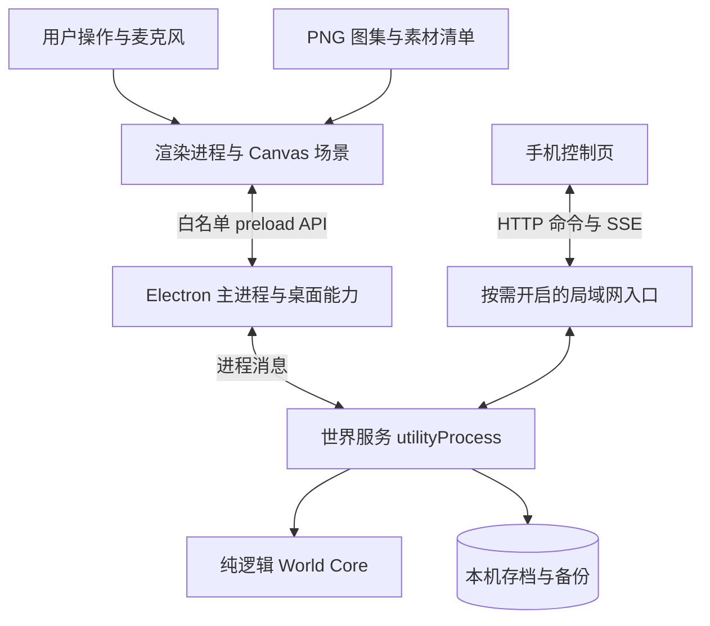

# 息屿桌面产品架构方案

设计日期：2026 年 10 月 18 日。目标：可长期使用、可安装更新、离线可用的像素桌面小岛。本文是目标架构与迁移计划，所列能力不代表当前代码已经实现。

建议延续现有 Electron 与 Canvas 技术路线，采用一个仓库、一个安装包、模块化设计。让一个本地世界服务独占世界状态和存档，渲染界面负责表现；通过暂停绘制和按时间差计算生长降低后台耗电。手机互动作为按需开启的局域网功能。

## 产品范围与关键取舍

首版包含小岛展示、植物生长、猫狗鸟松鼠等生物、送风落雨播种投喂、昼夜变化、桌面悬浮、自动存档、存档导入导出和安装发布。美术使用温暖像素风、三分之四俯视与 PNG 图集。

先以 macOS 为首发平台，这是根据当前开发环境作出的实施假设；模块边界保留 Windows 适配。首版桌面形态定义为可拖动的透明悬浮窗，提供置顶开关、交互模式和鼠标穿透模式。嵌入系统壁纸层属于另一项平台能力，需单独验证后排期。

账号、云存档、跨网络多人协作不进入首版依赖。运行时不需要大模型：动物行为通过状态机、规则和随机性表现，核心体验可完全离线运行。

| 层次 | 建议选型 | 取舍 |
| --- | --- | --- |
| 桌面容器 | Electron，TypeScript 渐进迁移 | 复用已有窗口和音频能力；需持续治理内存与后台耗电 |
| 场景 | Canvas 2D，PNG 图集，现有 HTML/CSS 控件 | 先控制场景规模；经性能剖析确认渲染瓶颈后才评估 PixiJS |
| 世界规则 | 无 DOM、无 Electron 依赖的 TypeScript 模块 | 在独立进程和测试中共用，便于将来更换渲染器 |
| 本地服务 | Electron utilityProcess | 隔离世界模拟与文件写入，主进程负责监督 |
| 存储 | 版本化 JSON 快照、原子替换、轮换备份 | 单岛、小数据量足够；大规模查询或多岛数据出现时再迁移 SQLite |
| 手机通信 | HTTP 命令与 SSE 状态推送 | 沿用已有通信方式，首版只做低频互动 |
| 构建发布 | Vite、TypeScript、Electron Forge | 保留单 package.json；通过目录建立边界即可 |

utilityProcess 提供 Node.js 子进程和消息通信能力，适合作为本地世界服务的进程容器。[Electron utilityProcess 文档](https://www.electronjs.org/docs/latest/api/utility-process)

## 进程与职责



图中世界核心、存储适配器和局域网入口都是世界服务内的模块，不是额外部署的服务；Electron 自身的 GPU 等辅助进程未画出。

**主进程**管理窗口、托盘、快捷键、权限、电源状态、更新与世界服务生命周期。它验证渲染器 IPC 的来源和参数，转发业务命令，不参与每帧绘制和世界规则计算。

**世界服务**是唯一有权修改世界状态和写正式存档的地方。它加载存档、串行处理命令、推进时间、发布状态变化。渲染器重载后请求完整快照，不能自己重新创建或覆盖世界。世界服务崩溃时，主进程停止接受新操作，限次重启并从存档恢复；连续失败进入可导出存档的恢复界面。

**渲染进程**只维护世界状态的只读副本，以及粒子、动画帧、悬停和拖拽预览等视觉状态。鼠标、麦克风、演示脚本全部转为命令。界面可以立即显示播种预览，植物正式出现以世界服务的结果为准。

桌面生产页面从应用内的固定自定义协议加载，例如 `island://app/`，通过 IPC 访问世界；局域网服务关闭时桌面仍能正常启动。注册协议时配置标准与安全上下文能力，并在目标 Electron 版本验证麦克风权限链。浏览器开发模式可用 Node 启动同一世界服务，通过 HTTP 适配器连接，使用独立开发存档目录。

渲染器保留 `nodeIntegration: false`、`contextIsolation: true`、`sandbox: true`，增加严格 CSP、IPC 来源校验和按能力开放的权限处理。[Electron 安全指南](https://www.electronjs.org/docs/latest/tutorial/security)

## 世界核心与数据边界

核心规则以输入状态、命令、时间与受控随机数为参数，不读取屏幕大小、真实文件路径或浏览器状态。建议接口如下，具体类型在实现阶段固化：

```ts
createWorld(seed, catalog): WorldState
applyCommand(state, command, context): CommandResult
advanceWorld(state, elapsedMs, policy): WorldUpdate
restoreWorld(snapshot, now, catalog): WorldState
```

| 模块 | 负责内容 |
| --- | --- |
| 地形 | 可种植区域、可行走区域、海岸与障碍物 |
| 植物 | 品种、年龄、水分、生长进度、五个生长阶段与开花条件 |
| 动物 | 闲逛、觅食、靠近、进食、休息；鸟类补充飞行与栖息 |
| 环境 | 风雨、潮位、昼夜和环境对植物的影响 |
| 命令 | 参数校验、权限、重复请求识别、规则执行与结果 |
| 内容目录 | 物种规则、素材 ID、默认数值和资源版本 |

动物先使用有限状态机和小型导航网格；增加新物种通常只需配置速度、活动范围、食物偏好、行为权重和素材 ID。猫与狗可共享行为系统，鸟类通过独立移动策略扩展。暂不引入通用 ECS、物理引擎或脚本插件系统。

植物使用连续 `growthProgress` 与离散 `stage: 0 | 1 | 2 | 3 | 4`。阶段由核心根据进度与物种规则确定，界面只展示结果；存档同时记录进度、阶段与规则版本，加载时校验一致性。每个物种配置五阶段的阈值、条件、名称和素材 ID，例如花卉为萌芽、幼苗、展叶、花苞、开花；果蔬和树木使用自己的阶段语义。不同阶段需要结构变化的图片，不能只把成熟素材从小放大。离线补算使用同一套生长规则，一次跨过多个阶段只展示最终状态及简短反馈。

持久状态至少包含 `schemaVersion`、`contentVersion`、`worldId`、`seed`、`rngState`、`revision`、`savedAt`、`simulatedAt`、地形布局、植物、生物长期属性和用户设置。运行期间保留动物位置与行为状态，读档时对过时目标重新规划。粒子、当前动画帧、鼠标位置、音频原始数据与邀请令牌不进入存档。

世界使用独立于屏幕的逻辑坐标；相机把它转换为 Canvas 坐标。点击通过反向变换得到世界坐标，再由核心判断该位置能否播种或投喂。改变窗口大小、分辨率或美术尺寸不得改变植物位置与碰撞规则。

## 命令和状态流

一次播种的流程为：

1. 界面将用户操作转换为带 `clientId`、`clientSeq`、`commandId` 和世界坐标的命令。
2. 接入层验证来源、大小、频率与权限；客户端身份来自已建立的会话，不能信任请求自报的角色。
3. 世界服务串行校验土地和资源，产生候选状态，持久化播种结果与去重记录。
4. 写入成功后提交候选状态，返回结果并广播带版本的状态变化；界面将预览替换为正式植物。

不同输入共用同一套核心命令。现有 `wind`、`rain`、`seed`、`food`、`tide`、`fireflies` 可通过兼容适配器逐步接入，迁移期间无需同时重写全部控件。

通信消息区分三类：

- **命令结果**：明确 `accepted`、错误原因，以及是否已持久化。已接收不等于已保存。
- **状态快照或变更**：包含 `worldId`、`hostEpoch`、`revision`；增量再带 `baseRevision`。客户端发现版本断层就请求快照。
- **短暂视觉事件**：例如一阵风、涟漪、闪光，带过期时间；断线后不回放已过期事件。

`hostEpoch` 在世界服务重启时改变，让客户端主动放弃旧副本。SSE 使用协议级 `id:`，不能只在 JSON 里放 ID。重连优先发送当前快照，不要求无限事件日志。HTTP 响应与 SSE 事件可以先后到达，界面通过命令 ID 和版本合并，不重复执行。

每个会话持有递增 `clientSeq`，持久命令按客户端队列依次提交，世界服务对缺失序号要求补齐或重新同步，避免把乱序请求误判为已经执行。世界服务保存已应用序号及有限结果记录；对已经执行但结果已淘汰的请求，返回“已处理，请同步”，不能再次执行。持久命令的去重信息与状态同一次落盘；失效会话必须重新同步，不能重放积压的旧操作。连续风力等可覆盖输入走单独的序号通道，以最新值为准。

吹气和拖动潮位按变化阈值、最多每秒 10 次合并输入，短暂风力另设超时自动归零，避免鼠标松开或手机断线后持续送风。命令队列设上限，积压时合并连续控制量，不能无限堆积。

## 存档与恢复

正式存档放在 Electron `app.getPath('userData')` 下固定的产品目录，不放在安装目录、仓库或某个 HTTP 端口的 localStorage 中。统一并固定应用内部名称与存储路径，避免“息屿”和“一息”改名导致存档目录变化。多进程写入由单实例机制与存储目录锁共同防止。

首版目标是单岛快照控制在约 2 MiB 内；这是用于验证的设计预算。达到上限前先限制无界实体增长并剖析序列化成本。需要多岛查询、长历史或写入明显变重时，将 `SaveRepository` 内部替换为 SQLite，世界规则与渲染协议保持不变。

写入采用同目录临时文件、完整写入、文件同步、校验、原子替换，并在平台支持时同步目录；轮换保留最近 3 份已验证备份。写入与备份操作串行执行，不先删除唯一有效主存档。原子替换和异常断电恢复必须在每个发布平台实测，不把进程崩溃安全等同于绝对断电零丢失。

- 播种、移除、布局、物种解锁等重要修改，在写入成功后才显示“已保存”；短时间连续操作可合并为最长约 250 毫秒的一批。
- 自然生长与累计浇水等变化，脏状态每 30 秒保存一次；这些变化可能回退到最近检查点，并按规则补算时间。
- 进入休眠前、主动退出与安装更新前请求立即保存；主进程等待保存回执后结束世界服务。常规自动保存承担可靠性，不能只依赖退出事件。
- 磁盘满或写入失败时保留旧文件，明确显示保存失败；需要持久确认的命令不提交，允许导出最后有效状态。
- 启动顺序为主存档校验、备份恢复、恢复界面。发现损坏时保留原文件，不静默创建新岛覆盖它。
- 迁移遵循 `v1 -> v2 -> v3`，在副本上完成并先备份。旧程序遇到更高版本存档时拒绝写入；降级程序不能覆盖升级后的数据。
- 导入限制文件大小、实体数量、字段类型和坐标范围，验证成功后再备份并替换。存档不能携带可执行脚本或任意文件路径。

离线生长通过 `now - simulatedAt` 按规则直接计算，首版建议最多结算 24 小时，并把它作为可调整的产品规则。时间倒退时按 0 处理，异常前跳按上限处理；运行时用单调时钟计时。休眠恢复不逐帧重演所有雨滴和动物移动。建议采用温和规则：离线期间不因缺少照料导致宠物死亡。

隐藏期间收到浇水等命令时，先结算到服务端接收该命令的时间，再应用新效果，避免把刚浇下的水错误作用于整段离线时间。保存中的命令与定时更新也经过同一串行队列，不能让旧快照覆盖更新的状态。

## 低功耗调度与画面

世界生长不依赖渲染帧数。下表为起始调度预算，应根据真实机器测量调整。

| 状态 | 绘制 | 动物与环境 | 植物 |
| --- | --- | --- | --- |
| 前台正在操作 | 默认 30 FPS，可选 60 FPS | 活跃时约 10 Hz，画面插值 | 约 1 Hz 或到期更新 |
| 可见但无交互 | 15 至 24 FPS | 约 2 Hz，减少寻路 | 约 1 Hz 或到期更新 |
| 隐藏或最小化 | 停止 rAF 绘制 | 暂停视觉行为，收到命令时唤醒 | 读取或恢复时按时间差结算 |
| 锁屏或休眠 | 停止绘制、释放麦克风 | 停止模拟循环 | 唤醒时按时间差结算 |
| 电池或高温 | 降到 15 FPS、减少粒子 | 降低更新频率 | 保持时间语义 |

保留 `backgroundThrottling`；综合窗口事件、Page Visibility 与电源事件决定模式。仅用“失焦”判断后台会错误暂停仍可见的桌面小岛。macOS 的页面可见性还包括完全遮挡，其他平台不能直接假定有相同遮挡检测。[BrowserWindow 可见性说明](https://www.electronjs.org/docs/latest/api/browser-window#page-visibility)、[powerMonitor 文档](https://www.electronjs.org/docs/latest/api/power-monitor)

Canvas 优化顺序：缓存静态地形，限制实体与粒子数量，复用对象与贴图，避免每帧创建 DOM 或读取像素，最后再考虑更换渲染器。建议先用约 640 × 360 的逻辑画布验证；根据窗口比例留边或扩大可见区域，尽量整数倍缩放，不随 Retina DPR 无上限增加像素数量。

场景从后向前绘制海面、岛屿底层、地面物件与动物、树冠等遮挡层、天气粒子和夜间光效；地面对象以脚底世界 Y 坐标排序。鸟类飞行增加高度信息。交互区域使用独立地形数据，不依赖 PNG 透明像素。

发布前固定一台基准机、分辨率和场景，例如 300 株植物、30 只动物、200 个粒子；记录前台帧耗时 P95、全进程 CPU、内存、后台唤醒和电量趋势。初始目标为前台 30 FPS、隐藏无绘制、连续 8 小时内存无持续上升；这些是验收目标，当前尚无实测结论。Electron 的常驻开销需纳入测量，如果仍无法满足续航目标，再用相同场景评估其他容器。

## 美术与内容接入

运行素材放在 `public/assets/pixel-world/`；`art/` 保存创作说明与参考。当前美术协作方向包括主视觉、4 类小岛、24 款动物，以及 24 种植物各 5 个生长阶段。植物计划分为 4 张五列六行图集，每行一个物种、每列一个阶段；数量和实际可用切图以交付检查为准。

原始 `atlas.json` 由美术侧记录真实切图坐标。工程通过适配器生成统一的运行清单，避免要求美术重排已经完成的图集。每个资源至少有稳定 ID、图片路径、矩形区域、原始尺寸、脚底锚点与透明留白信息；规则目录再把 `speciesId` 映射到对应资源 ID。

静态图集不能直接视为动画序列。首版可通过单帧平移、轻微起伏与朝向变化表现活动；具有专门绘制的连续帧后，再补充 `idle`、`walk`、`eat`、`sleep` 等动画定义。非对称生物不默认镜像。

植物五阶段对应独立素材，不把不同品种误认为生长帧；缩放只用于阶段切换时的短暂视觉过渡。某阶段素材暂缺时可用占位图完成集成，但五阶段表现是正式内容验收项。绘制关闭 `imageSmoothingEnabled`，CSS 保留 `image-rendering: pixelated`。素材缺失时保留实体，不能因换皮肤删掉用户养成内容。

构建阶段校验资源存在、切图越界、重复 ID、锚点、帧时长与透明通道；手动检查清晰度、遮挡、边缘和统一像素密度。先按实测尺寸登记，不假设生成图严格遵守等宽网格。配套约定见 `art/INTEGRATION_REQUEST.txt`。

## 手机互动和音频

邀请由桌面本地 IPC 发起；用户开启“一起造风”后才启动局域网监听，结束邀请即撤销会话并关闭监听。显示可选择的实际网卡地址和热点方案，不能固定采用系统返回的第一个地址。

邀请凭证随机、短期有效；可放在链接 fragment 中，再由控制页交换为受限会话，避免长期留在请求 URL 和日志中。房间展示码只用于辨认，不作为凭证。手机仅获得送风、浇水、投喂等允许的能力，不能访问文件、存档管理和桌面控制；管理接口只走 IPC。现有“本机请求自动授权”应替换为明确的会话与权限检查。

入口校验 Host、Origin、请求体和操作频率，限制连接数与写缓冲；慢速 SSE 客户端应断开后重新同步，不能拖住世界服务。连接数与在线人数按会话统计，避免刷新和多标签重复计数。共享网络的 HTTP 功能只定位为低敏感度的本地互动；临时令牌不能代替传输加密。

手机首版提供按钮和长按送风。普通局域网 IP 的 HTTP 页面通常不具备麦克风所需的安全上下文；如果以后必须支持手机吹气，需要可信 HTTPS 与手机浏览器权限方案。[MDN getUserMedia 文档](https://developer.mozilla.org/en-US/docs/Web/API/MediaDevices/getUserMedia#privacy_and_security)

桌面吹气只在用户开启后采样，完成噪声校准和平滑处理，只把归一化风力传给世界服务。锁屏、页面关闭、麦克风断开与用户停用时释放音轨；环境音关闭时暂停 AudioContext。应保留按键和触控操作作为同等可用入口。

## 安装更新与运维

使用 Electron Forge 建立从构建、打包、签名到更新产物的一条流水线。项目使用 pnpm，接入 Forge 时按官方要求配置 `node-linker=hoisted` 并验证安装包依赖完整；目前工作区中的构建脚本放行设置也要改成实际布尔配置并在干净环境复验。[Electron Forge 文档](https://www.electronforge.io/)

首发 macOS 分别构建并测试 arm64 与 x64，提供安装包及更新所需产物；正式分发完成代码签名和公证。Windows 阶段选择与内置 autoUpdater 匹配的 Squirrel.Windows 安装与更新链。签名证书和凭据由发布环境提供，不能提交到仓库。[Electron 签名文档](https://www.electronjs.org/docs/latest/tutorial/code-signing)、[Electron 更新文档](https://www.electronjs.org/docs/latest/tutorial/updates)

更新元数据与安装包走 HTTPS；下载后允许用户选择重启时机，重启前保存并完成回执。区分测试和稳定渠道，失败时保持当前可启动版本。更新迁移前保留存档备份；程序回退与存档回退分别处理。

本地保留限额轮换日志，记录启动、存档恢复、资源缺失、世界服务退出和更新结果；不记录邀请令牌、原始音频或完整个人路径。提供“导出诊断”入口，默认不上传。依赖锁定具体安装版本，定期检查受支持的 Electron 版本并执行升级回归。

## 建议目录

```text
desktop-world/
  desktop/                    # 主进程、preload、窗口、电源与更新
  src/
    core/                     # 状态、规则、时间、随机数与地形
    host/                     # 世界服务入口、队列和调度
    persistence/              # 快照、备份、迁移与目录锁
    transport/                # IPC 协议、HTTP 与 SSE 适配
    renderer/                 # 相机、场景层、精灵、输入和音频
    content/                  # 物种定义、资源映射与运行清单
    shared/                   # 消息类型与输入校验
  public/
    assets/pixel-world/       # PNG 与原始图集清单
    phone.html                # 手机控制页入口
  art/                        # 美术说明与集成约定
  tests/                      # 核心规则、存档、协议与安装回归
  docs/ARCHITECTURE.md
```

现有 `public/index.html`、CSS、音频模块与 Electron 窗口代码可以逐步迁移。目录描述目标结构，不要求先把所有文件搬完再交付功能。

## 迁移顺序与验收

代码审阅时已有 Electron 壳、preload 白名单接口、Canvas 页面、音频模块、HTTP 命令与 SSE 广播。当前 `server.cjs` 主要转发动作，没有承担权威世界状态或可靠存储；SSE 消息尚未写协议级 `id:`；服务启动即监听局域网。界面上的存档文案不能替代持久化验收。

| 阶段 | 实施工作 | 完成标准 |
| --- | --- | --- |
| 1 世界规则 | 明确状态模型、命令类型、素材 ID；抽离生长与动物规则 | 同样种子、时间和命令产生可复现结果；调窗口不改变世界 |
| 2 可靠状态 | 世界服务独占状态；完成保存、恢复、版本迁移和退出握手 | 播种后重开仍在；重载渲染器不重置；写入途中终止可恢复 |
| 3 内容体验 | 接入小岛、植物、动物图集和桌面交互模式 | 能选择、种植、投喂；脚底遮挡正确；素材缺失不丢存档 |
| 4 常驻运行 | 电源调度、托盘、鼠标穿透恢复、音频释放、多屏适配 | 锁屏无绘制；唤醒正确补算；连续 8 小时运行无持续泄漏 |
| 5 手机互动 | 按需监听、受限会话、去重、重连与慢连接处理 | 多手机操作有序；重试不重复播种；关邀请后旧链接失效 |
| 6 正式分发 | 安装包、签名、公证、更新、导出存档与诊断 | 无 Node 开发环境可安装运行；旧版本升级保留世界；失败可恢复 |

先完整验证“启动 → 播种 → 保存 → 退出 → 恢复 → 休眠唤醒”这一条纵向流程，再增加物种与复杂特效。

关键自动化测试覆盖命令去重、无效地形、离线时间上限、保存失败、损坏备份恢复、旧版迁移和状态重连。桌面验收覆盖多显示器、缩放、穿透模式恢复、麦克风拒绝、断网、磁盘满和已安装应用更新。测试应验证行为与故障恢复，不只检查语法。
