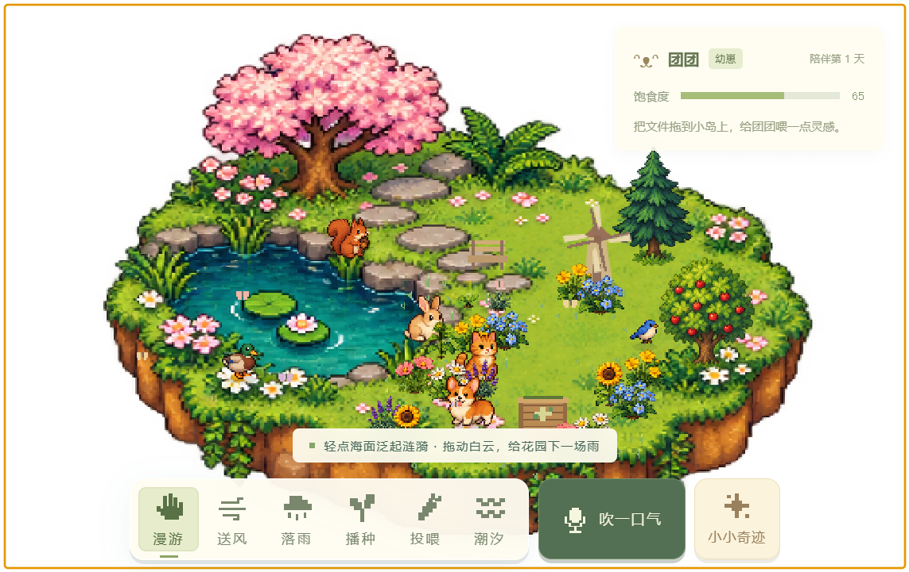

# Windows 开发与使用

这版以 [Discussion #4：Windows 开发指南](https://github.com/stephenzsl2007-del/hackathon-agent-hub/discussions/4) 为依据，在 `codex/windows-experience` 分支开发。已接入 Am1Reux7 的 `640a364` 更新；仅提交、推送本 Windows 分支，不修改协作者的 macOS 分支或合并回 main。

## 运行与分发

在 Windows 原生 PowerShell 中使用 Node.js 24、pnpm 11.25.0：

```powershell
cd desktop-world
pnpm.cmd install --frozen-lockfile
pnpm.cmd desktop
pnpm.cmd check
pnpm.cmd test
pnpm.cmd package:win
```

安装依赖后也可双击 `start-windows.cmd`。构建输出为 `dist/Xiyu-1.0.0-win32-x64/` 和同名 ZIP（架构随本机 Node/Electron 而定）。完整解压后双击 `Xiyu.exe`，保留同目录全部文件，无需另装 Node.js。`package:win --no-zip` 可跳过压缩。当前是未签名便携版，没有安装器和自动更新。

默认存档在 `%APPDATA%/息屿/`。开发验收可先设置 `$env:XIYU_PROFILE_DIR = '一个绝对路径'`，用独立配置隔离日常存档；关闭该 PowerShell 或移除这个环境变量后恢复默认目录。

## 操作

| 操作 | Windows 入口 |
| --- | --- |
| 打开工具 | 右键小岛；画面中的凳子、堆肥箱、风车也有入口 |
| 移动 | 直接拖动岛屿；也可按住 Alt，或右键「移动花园」。轻点仍触发互动，拖太阳和云仍控制天气 |
| 找回与恢复交互 | Ctrl+Alt+Shift+G；通知区域小叶子可打开相同菜单 |
| 文件投喂模式 | Ctrl+Alt+Shift+F |
| 退出 | 托盘「完全退出息屿」或花园有焦点时 Alt+F4 |

默认使用右下角透明、无边框窗口。设置可调整大小、位置和置顶。Windows 默认交互模式保持鼠标可用，避免自动穿透误将面板和岛屿点击交给下层应用；窗口内透明空白也会接收鼠标。需要操作下层时可主动选择完全穿透，再按 Ctrl+Alt+Shift+G 找回。Windows 不支持 Electron 的 `setVisibleOnAllWorkspaces`，因此这里只承诺当前虚拟桌面，切换虚拟桌面时可能暂时看不到花园。

完成专注获得 3 滴水，每滴使一株尚未开花的小苗成长一个阶段；没有可成长植物时保留水滴。演示会在 26 秒后恢复日常花园，也可提前结束；演示中的风雨、点心和种子不会延续到日常状态。

邀请面板可选择网卡地址并刷新二维码，优先普通网卡，降低 WSL、VPN、Clash/Meta 等虚拟网卡的优先级。手机与电脑需要互通的同一 Wi-Fi/热点；首次联网如系统提示，可允许专用网络访问，无需管理员运行或关闭防火墙。手机收到成功提示代表花园已执行；断线与确认超时会明确显示，操作不会自动重放。

## 长岛同步与互动扩展

按用户最新选择同步 Am1Reux7 的长岛素材、布告栏、工具条与面板，保留透明、无边框窗口。`public/habitat-world.js` 在原世界之上添加玩法，沿用协作者的 UI。Rusty’s Retirement 的借鉴点是忙碌的小邻居、可观察的环境反馈和工作时的陪伴，不增加任务压力。

交互区域、雨滴落点、出生点和存档布局共用上游 `scene-profile.js` 的长岛配置。动物跟随、集合、避雨和新邻居入岛复用 `animal-motion.js` 的寻路、加减速与转身；猫使用协作者交付的 4 帧行走、2 帧待机和 2 帧进食动画，其余物种继续使用现有素材。雨云、雨滴与池塘涟漪也复用新版 World。旧圆岛存档迁移到长岛的可用区域，保留植物、动物与资源；窗口设置一次性适配长岛比例。

| 互动 | 反馈 |
| --- | --- |
| 右键「后台键盘雨」 | 在其他软件敲键也会出现乌云和雨线；连续输入时雨更密，停下后渐退 |
| 送风、麦克风送风或右键「看一场风雨」 | 树冠、树枝和花草倾摆，落叶与风线经过；陆地动物跑到树边避风雨 |
| 点樱花树、松树、苹果树 | 树枝晃动、落花或落叶；苹果树掉落互动点心，动物聚来分享 |
| 点动物后移动光标 | 冒出爱心和文字反馈，短暂跟随；点池塘会溅水，鸭子扑腾 |
| 在空草地快速点三次 | 邻居向点击位置聚拢 |
| 右键「邀请动物邻居」 | 可邀请兔子、小鸟、松鼠或鸭子；间隔 4 秒，上限 12 位，随日常存档恢复 |
| 拖走天空中的太阳 | 小岛渐入夜色；右键「请太阳回来」可恢复 |

键盘雨默认关闭，开启选择会保存在窗口设置。Windows 助手只报告每 250 毫秒内是否发生敲键，不读取键码、文字、窗口标题或应用名称，不上传或持久化输入记录。隐藏、锁屏、休眠时停止助手；恢复显示或解锁后仅恢复原先开启的状态。退出会释放钩子。键盘雨只提供反馈，不自动发放水滴或加速植物成长。便携包内含编译好的助手；源码开发首次开启时用系统 Windows PowerShell 编译到当前配置的 native 缓存。

右键「平行桌面 → 在桌面创建互动文件夹」会新建独立的「息屿互动桌面」；同名已存在则使用新名称。也可由你在系统选择器中关联现有普通本机文件夹。

- 「太阳.txt」或 `sun.txt` 在文件夹里时有太阳，移走后渐入夜色，移回后恢复。手动开启的夜色仍保留。
- 新建「风.txt」/`wind.txt`、 「雨.txt」/`rain.txt` 可持续送风或落雨；移走后天气渐退。
- 放入 PNG/JPG/WebP/BMP 图片会出现带相片头像的访客，移走图片则离开。最多显示 8 位，单张不超过 10 MB；只在本机生成 64 像素缩略图，不上传、不写入花园存档。
- 关联仅作用于当前运行会话，不递归扫描子文件夹、不读文本正文、不跟随图片链接、不移动或删除源文件。断开后恢复花园自身的天气；重启后需重新关联。

拖动改为主进程读取系统光标坐标，按起点计算绝对位移，每 16 毫秒更新一次；释放、失焦、隐藏或 Escape 时停止。在非整数缩放下固定拖动起始尺寸，避免原先位置反馈循环造成抖动和窗口累计变大。

按下后移动超过 5 像素才搬动窗口；渲染端只启动一次原生拖动，松手补采样最终光标坐标。跨屏时按光标所在屏幕的工作区域约束窗口。隐藏或锁屏期间暂停绘制并释放麦克风；恢复后麦克风需手动重新开启。隐藏时更改键盘雨开关会保存选择，但仍暂停采集。平行桌面断开、连续切换目录及扫描时移走图片均可取消旧请求，不会被迟到操作重新关联。

非整数 DPI 下原生移动可能引发相邻像素的尺寸变化。Canvas 仅在实际尺寸变化时重设缓冲区，并在同次 resize 中立即补画；不会等待下一次 30 FPS 帧，从而避免拖动时短暂清空造成的闪烁。

## 文件与保存边界

文件投喂先显示清单，逐批确认后才调用系统回收站。本地盘符下的普通可写文件才可处理；文件夹、链接/junction、系统和程序目录、AppData、回收站、程序及存档自身均拒绝。路径比较兼容 Windows 大小写、盘符和长路径前缀；UNC 网络共享与设备路径一律拒绝，防止用共享别名绕过本地保护。测试只使用自行创建的临时文件及替代回收函数，没有移动用户文件。

保存失败时保留上一份磁盘存档。退出时如最终保存失败或花园未回应，可重试、返回花园，或明确选择仍然退出。`tests/verify-native-trash.cjs` 专用于 macOS，Windows 会直接拒绝运行。

## 本机验收记录

2026-10-18：Windows 11 Home 64 位，系统版本 10.0.26200；Node 24.15.0，pnpm 11.25.0。以下在构建后的 `Xiyu.exe` 和独立临时配置中执行：

- 透明窗口和像素素材成功显示，使用真实 Windows 窗口检查画面。
- 完全穿透时实际点击岛屿，下层专用测试窗口计数从 0 增至 1；实际按 Ctrl+Alt+Shift+G 恢复交互，两个快捷键均注册成功。
- 1 分钟真实计时、暂停与继续，完成后获得 3 滴水；使用一滴后余额为 2，小苗推进一阶段。
- 手机尺寸浏览器页面播种，花园植物数增加 1 后才显示成功；二维码加载成功，网卡选项可列出。
- 提前结束演示及完整演示后，日常植物恢复，雨、风源、飞行种子与点心均清空。
- 制造临时写入失败后关闭窗口，成功触发保存失败分支并保留花园；移除故障后保存成功。
- 实际 Alt+F4 正常退出，再启动最终便携版：19 株植物、2 滴水和已完成专注均恢复，没有重复发放奖励；WLAN 排在虚拟网卡之前。
- 16 项自动测试全通过、无跳过：存档、退出握手、回收保护与 junction、服务异常输入、手机回执和超时、网卡排序、演示恢复与浇水资源。



此前圆岛互动扩展的验收（2026-10-18）：29 项自动测试通过；原生窗口实际系统敲键触发了键盘雨，隐藏后助手暂停、显示后恢复；临时关联文件夹的图片新增、太阳移走与风雨状态均作用到岛屿，照片不会进入存档；完整 26 秒演示后日常植物、动物和资源恢复，临时天气、种子与点心清空，页面无异常。165% 缩放下，以受控系统光标坐标连续验证 3 轮原生移动，位移正确，尺寸误差保持在 2 DIP 内，没有随更新次数累计放大。

最新长岛 Windows 适配验收（2026-10-18）：143 项自动测试及全部 JavaScript 语法检查通过，Windows 便携包与 ZIP 构建成功。日常窗口实机点击打开专注面板、点击关闭、拖动手柄后再次点击布告栏成功；自动穿透不再拦截 Windows 控件。独立配置中的便携版正确加载长岛与猫动画，复制的日常存档恢复 22 株植物、6 位动物。受控原生尺寸变化触发 51 次 ResizeObserver 通知，未采到空白 Canvas 帧；实机完成一次手柄拖动，但长时间手感仍需用户确认。

便携版完整 26 秒演示后，植物数、动物数、资源和昼夜状态与演示前严格比对一致，页面无异常。使用本机 Chrome 的手机尺寸页面播种，收到桌面执行回执后花苗数恰好增加 1；邀请面板能列出 3 个网卡地址并加载二维码。以上使用独立临时配置，正常保存退出，不改日常存档；这不等同于实体手机的 Wi-Fi 连通性验收。

尚需现场补测：长时间拖动手感、其他 DPI/多显示器插拔、系统实际休眠唤醒、实体麦克风、不同手机通过 Wi-Fi 入站连接、系统回收站真实移入和恢复、长时间运行。上述项目没有用单元测试结果代替实机结论。GitHub Actions 配置了 Windows/macOS 检查，Windows 额外执行便携构建。
